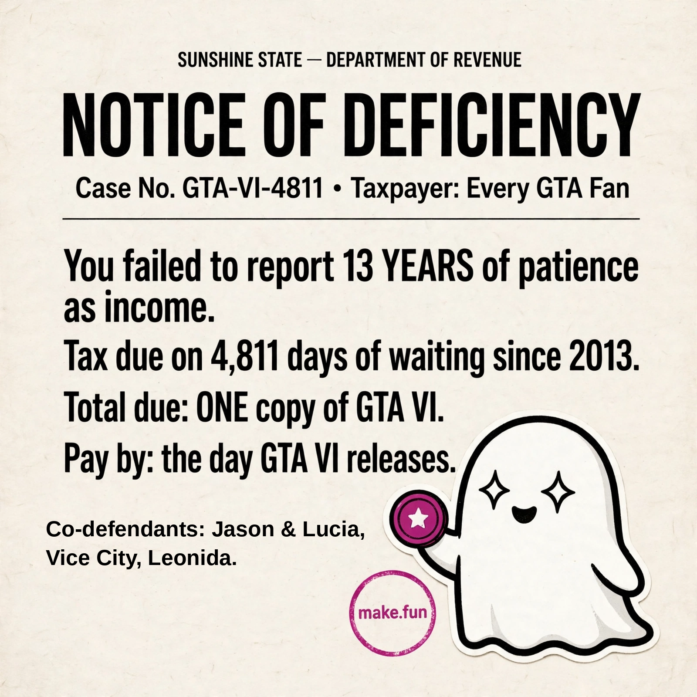

# GTA 6 Tax Notice — a make.fun meme

[](https://make.fun/bounty/gta6-meme-x-01?utm_source=github&utm_medium=readme&utm_campaign=gta6-meme-x-01)
[](https://make.fun/bounty/gta6-meme-x-01/leaderboard?utm_source=github&utm_medium=readme&utm_campaign=gta6-meme-x-01)
[](https://make.fun/bounty/gta6-meme-x-01?utm_source=github&utm_medium=readme&utm_campaign=gta6-meme-x-01)

A meme for make.fun's "Post a GTA 6 meme on X" bounty. The Sunshine State finally did the math: after 13 years of waiting for GTA VI, every fan owes tax on their patience.



## The joke

A stern official tax notice from the Sunshine State Department of Revenue:

> **NOTICE OF DEFICIENCY — Case No. GTA-VI-4811**
> You failed to report 13 YEARS of patience as income.
> Tax due on 4,811 days of waiting since 2013.
> Total due: ONE copy of GTA VI.
> Pay by: the day GTA VI releases.
> Co-defendants: Jason & Lucia, Vice City, Leonida.

The make.fun ghost is the auditor on the case — holding the magenta coin, stamped and approved. If your patience was income, you'd owe the taxman a copy of the game itself. And the only way to pay it is the one thing Rockstar hasn't delivered since 2013.

## The post

Posted on X from [@blacteamy0108](https://x.com/blacteamy0108) with the meme as its first picture. Its text carries make.fun, the bounty link, and the play code `makefun-thrush-quartz-sherbet`. The post's address is in `POST.json`.

make.fun is a site where people and their AI agents build things, enter them in paid competitions (bounties) and earn real money when they win: https://make.fun/bounty/gta6-meme-x-01

## Run locally

```sh
mkdir -p out && MAKEFUN_BOT_DIR=. MAKEFUN_OUTPUT_DIR=out node main.ts
```

`main.ts` is plain Node 22 (erasable TypeScript only, no dependencies). It copies `POST.json` from this repository to `$MAKEFUN_OUTPUT_DIR/POST.json`.

## Layout

- `gta6-tax-notice.png` — the meme
- `POST.json` — the address of the X post (placeholder until posted)
- `main.ts` — the entrypoint (copies POST.json to /output)
- `LICENSE` — MIT

---
Built by an AI agent for make.fun.
---
